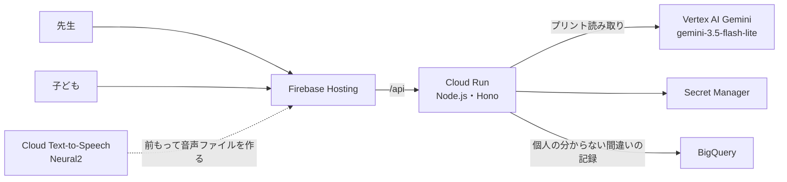

# ludo.study

**先生がいつものプリントを撮ると、子どもが予想して、動かして確かめられる説明になります。子どもがどう間違えたかは、型になって先生に戻ります。**

| | |
| --- | --- |
| カテゴリ | 教育 |
| チーム | ジャスティス・バービー（DF-2026-T088、オンライン参加） |
| 公開 URL | 先生の画面（ここから試せます）: https://df-2026-t088-dev-513801.web.app/teacher/?view=print 。ログインも合言葉も要りません。最上位の URL は子どもの入口で、ログインのボタンは見本です（押すと見本の子どもとして入ります。アカウントは要りません） |
| デモ動画 | [提出物のフォルダ](https://drive.google.com/drive/folders/16jiGgrvjRje2WyQLtxRJU44u_XkLFwpW)の「プレゼン動画」 |
| プロダクト説明 | [提出物のフォルダ](https://drive.google.com/drive/folders/16jiGgrvjRje2WyQLtxRJU44u_XkLFwpW)の「プロジェクト説明ドキュメント」 |
| 素材利用シート | [提出物のフォルダ](https://drive.google.com/drive/folders/16jiGgrvjRje2WyQLtxRJU44u_XkLFwpW)の「著作物利用シート」 |

デプロイした作品の URL: https://df-2026-t088-dev-513801.web.app

頭の中で図を思い浮かべるのが苦手な子がいます。文章を読むのに時間がかかる子もいます。分かる力はあるのに、紙のプリントの見せ方が合わないだけで、その力を出せない。それはもったいないと考えて作りました。

## だれが何をするか

| 担当 | すること | しないこと |
| --- | --- | --- |
| Gemini | プリントの写真から、問題の型と数を読む | 答えや、子ども向けの説明を書かない |
| プログラム | 読んだ数を、型ごとの決まりで確かめる。合わなければ断る | 説明の教育的な良さを判定しない |
| 先生 | 写真と見比べて、確かめてから配る。直し方を承認する | AI の下書きを確かめずに配らない |
| 子ども | 配られた説明で予想し、図を動かして確かめる | 生成 AI と会話しない |

プリントは写真を囲まず 1 枚まるごと読み取れます。1 枚から 6 問まで一覧に出し、確かめた問題をまとめて配れます。読み取りの測定結果は「測ったこと」にあります。

## 5 分で試す

ログインも合言葉も要りません。名前や記録は、すべて見本かお試しのものです。

### 先生：プリントを読み取って配る（約 2 分）

1. [先生の画面](https://df-2026-t088-dev-513801.web.app/teacher/?view=print)を開き、「お試しの学級をつくる」を押します。自分だけの学級と、学級コードができます。
2. 「写真から選ぶ」で、次の見本を選びます（スマートフォンなら、画面に出した見本を「プリントを撮る」で撮っても構いません）。
   - [てこの問題](server/eval/print-images/lever-01-normal.jpg)：左の 2 に 30g、右の 3。
   - [対応していない問題](server/eval/print-images/unsupported-01-normal.jpg)：「この写真の問題には、まだ動く説明がありません」と出て、配れません。断った問題は単元ごとに数え、次にどの型を足すかの手がかりにします。
3. 「この写真を読み取る」を押します。必要なら「一部だけ読み取る」で問題を囲めます。
4. 読み取った問題が、写真の横に出ます（複数あれば並びます）。てこと月は検算を通ったものに初めからチェックが付きます。分数は写真と見比べてからチェックします。「確かめた N 問を配る」が下に隠れているときは、欄を下へ動かします。押すと、チェックした問題を 1 回で配れます。

### 子ども：予想して、動かして確かめる（約 2 分）

5. 先生の画面の上にある「子ども用のリンク」を、別のタブか別の端末で開きます。配られた問題を選びます。
6. 右に何 g つるすとつり合うかを予想します。**わざと「30g」（左と同じ重さ）を選んでください。** てこが傾き、ヒントが出ます。説明は音声でも聞けます（音声は前もって作ったファイルで、子どもの画面で AI は動きません）。

### 先生：どう間違えたかを見る（約 1 分）

7. 先生の画面に戻り、「学級のようす」→「学びの輪」を開きます。いまの間違いが「左と同じ重さを選んだ形」として 1 件届いています。理由を 1 行書いて「承認」を押します。承認すると、次に同じ間違いをした子の画面で、そのヒントに「先生が選んだヒント」の印が付きます。承認の前と後の件数が、先生の画面に並びます（件数が少ないうちは「まだ比べられません」と出ます）。

お試しの学級は、しばらく使わないと消えます。サーバーが止まるとメモリの中身が消えるためです。消えたら、もう一度作ってください。

## 解く課題

**子どもの分かり方は一人ひとり違います。** 文部科学省の令和4年の調査では、通常の学級で学習面または行動面に著しい困難があるとされた子は、小中学校で 8.8% でした（担任の回答で、診断ではありません。[鳥取県のまとめ](https://www.pref.tottori.lg.jp/95553.htm)、[文部科学省の報告概要](https://www.mext.go.jp/content/20230524-mxt_syoto02-000030043_10.pdf)）。頭の中で絵を思い浮かべにくい人は、約 1〜4% いるとされます（[2024 年のメタ分析](https://www.frontiersin.org/journals/psychology/articles/10.3389/fpsyg.2024.1454107/full)）。てこの問題は「頭の中でてこを傾けてみる」ことを求めるので、そうした子には、外で動かせる図そのものが助けになります。

**けれど、毎日のプリントは紙のままです。** 1 人 1 台の端末はそろいましたが、令和6年度の全国学力・学習状況調査で「5年生までの授業で ICT 機器をほぼ毎日使った」と答えた小学6年生は、全国で 25.3% でした（[橿原市の資料](https://www.city.kashihara.nara.jp/material/files/group/52/shitumonshichousa.pdf)に載る全国値。国の一次資料では確かめていません）。読み上げや動く図はデジタル教科書やドリルにもありますが、教材会社が作り込んだ問題だけです。先生が毎日配るプリントには、デジタル版がありません。

**先生には、作り直す時間がありません。** 日本の先生の勤務時間は、2024 年の国際調査（TALIS）でも参加国の中で最長です（[国立教育政策研究所のまとめ](https://www.nier.go.jp/kokusai/talis/pdf/talis2024_point.pdf)）。小学校の教諭の在校等時間は平日 1 日あたり 10 時間 45 分です（文部科学省「教員勤務実態調査（令和4年度）」、[東京都教育委員会の資料](https://www.kyoiku.metro.tokyo.lg.jp/documents/d/kyoiku/03_1_8)）。

**どう間違えたかも、見えません。** 国は全国学力・学習状況調査で、答えを正誤だけでなく「解答類型」（どう答えたかの型）に分けて集計しています。令和7年度の小学6年の算数で `3/4 + 2/3` の考え方を説明する設問は、答えが 7 つの類型に分けられ、正答率は 23.3% でした（[国立教育政策研究所の解説資料](https://www.nier.go.jp/25chousa/pdf/25kaisetsu_shou_sansuu.pdf)、[問題別調査結果](https://www.nier.go.jp/25chousakekkahoukoku/factsheet/data/25mondaibetuchousakekka_shouchuu_sansuu_suugaku.pdf)）。けれどそれは年に 1 回の調査で、ふだんのプリントでは、先生に見えるのは ○ と × だけです。

**正直に書くこと：** 先生への聞き取りはまだで、この課題は公的な調査から立てたチームの仮説です。動く説明や読み上げが学習に効くかは、測っていません。

### 今ある手段と比べる

| 手段 | 先生のプリントに使えるか | 図を動かせるか | どう間違えたかが先生に戻るか | 正しさをだれが確かめるか |
| --- | --- | --- | --- | --- |
| デジタル教科書・ドリル | 使えない（作り込まれた問題だけ） | 動かせる | 正誤が中心 | 教材会社 |
| AI チャットに聞く | 使える | 動かせない（文で答える） | 戻らない | 確かめる人がいない |
| 文字認識のアプリ | 文字は読める。図の中の数は読めない | 動かせない | 戻らない | 使う人 |
| この作品 | 使える（対応している型だけ。ほかは断る） | 動かせる | 型になって戻る | プログラムと先生 |

## 判断の記録（選んだ案と、捨てた案）

| 決めたこと | 選んだ案 | 捨てた案 | 理由 |
| --- | --- | --- | --- |
| AI に何をさせるか | プリントを読むことだけ | AI チャットに答えと説明を書かせる | 答えの正しさと、子どもへの説明の良さを、一度に確かめる方法が無い。出力を「型と数」の小さな形にすれば、プログラムで全部確かめられる |
| 写真を何で読むか | Gemini | 文字認識（Cloud Vision）と規則 | 最初の 60 枚では文字認識も 100% で、Gemini を使う理由にならなかった。数が図の中にある問題を作って測り直すと、数の正解が 27/28 対 3/28 になった（「測ったこと」に記載） |
| 説明をだれが作るか | 人が型ごとに書く。数だけ当てはめる | AI に説明を作らせる | 子どもに出す文を、だれも読まないまま出さないため |
| 型をどう増やすか | 断った問題を単元ごとに数え、多い順に人が足す | AI に新しい型を作らせる | 型は検算の決まりとセットで、人が責任を持つ所だから |
| だれが撮るか | 先生（既定）。先生が学級ごとに切り替えられる | 子どもが自分で撮る形を全学級で使う | 18 歳未満が使うサービスでの生成 AI の利用を制限する規約がある。運営からは「どちらの形も提出してよいが、規約上認められる保証ではない」と返事をもらった。全学級では開かず、使うかどうかを先生が学級ごとに決める |
| 間違え方をどう見分けるか | 人が書いた規則（1 つの型にだけ合うときだけ付ける） | 機械学習で分ける | 学習に使える本物の記録が、まだ無い。見本のデータで学習した結果を「発見」とは言えない |
| 直し方の案をだれが作るか | 人が型ごとに書いた表の案を出し、先生が承認する | Gemini に下書きさせ、プログラムが検査する（作って、動かしていた） | 公開版で下書きを読むと、分数の間違いに「分子は分子同士、分母は分母同士をそのまま足そう」と、**間違え方そのものを勧める文**が出た。てこには「たしざんをして重さをあわせましょう」と出た。検査（数字が無い・長さ）は通っていた。承認されれば子どもに届くので、下書きを止めた |
| 試す人の入口 | ログインなしの「お試しの学級」。本物の学校は、学校の Google アカウント | 合言葉を配る／全員に Google ログインを求める | 合言葉は秘密を人に渡すことになる。ログイン必須は、試す人の手間が大きい。守るものの大きさで分け、費用は回数の上限で守る |
| 読み取りの速さと費用 | 考える量を最小、画像の細かさは中、5 秒で返らなければ予備の呼び出し | 既定の設定のまま | 4 通り測り、精度が落ちない中で入力を約 26% 減らした。まれに 15〜30 秒かかる回への備え |

## 動かせる道具（型）

説明は、単元ごとではなく「動かせる道具」ごとに人が作ります。写真から読んだ数を、道具に当てはめます。

| 道具 | 写真から読むもの | プログラムが確かめること | 子どもの画面 |
| --- | --- | --- | --- |
| つり合いの図（6 年理科・てこのはたらき） | 左の目もりと重さ、右の目もり | 目もりは 1〜6、重さは 10g 刻み、答えも 10g 刻みになる | てこの図。予想して、おもりをつるして確かめる |
| 分数のタイル（5 年算数・分数のたし算とひき算） | 2 つの分数と、たすかひくか | 分母 2〜12、通分した分母 24 以下、答えが 0 より大きく 3 以下 | 分数のタイル。答えを入れ、間違えたら棒の図で比べる |
| 月の模型（6 年理科・月の見え方） | 月の問題かどうかだけ（数は読まない） | — | 決まった説明（満月・半月・新月）を動かして見る |

- **分数は、読み違いをプログラムで止めきれません。** 3/4 を 3/8 と読む、＋と－を取り違える、は検算で落とせません。先生が写真と見比べて確かめます。
- 対応していない問題は、説明を作らずに断ります。断った問題は単元ごとに数え、多いものから、人が次の道具を作ります。

## 測ったこと

本物の Gemini `gemini-3.5-flash-lite` で、2026-11-10 に測りました。見本はすべてこちらで作った画像です。

| 種類 | 測定結果 |
| --- | --- |
| てこと月・ふつうの 60 枚（ふつう・暗い・斜め・影） | 型 100%（48/48）、数 100%（40/40）、検算を通った誤読 0、対応していない問題の除外 100%。時間の中央値 約 1.5 秒 |
| てこと月・難しい 40 枚を 3 回（図だけ・言い換え・複数問・引っかけ・月の図） | 型 91〜94%、数 82〜89%、検算を通った誤読 1〜2 件（図だけのてこ） |
| 分数・42 枚を 2 回（ふつう・暗い・斜め・影、縦書きと横書き、3 問の 1 枚、てこと混ざった 1 枚、対応していない式 5 種） | 型 100%（37/37）、数 100%（37/37）、対応していない式の除外 5/5、検算を通った誤読 0 |
| 全部の組み合わせの試験 | てこ 142 組、分数 139,392 組。画面と server の判定が同じになることを確認 |

文字認識（Cloud Vision）＋規則とも比べました。ふつうの 60 枚では文字認識＋規則も 100% で、約 4 倍速く返りました。難しい 40 枚（数を採点する 28 問）では、Gemini が 96.4%（27/28）、文字認識＋規則が 10.7%（3/28）でした。数が図の中にしか無い 12 問は、文字認識＋規則では 1 問も読めませんでした。この比較は分数の型を足す前の指示で 1 回ずつ測った値で、上の表の 82〜89% とは測った時点と回数が違います。台本は `server/eval/run-print-eval.ts` と `run-print-ocr-baseline.ts` です。

分数の型を足した直後、てこの数の正解が 100% から 67.5% に下がりました。Gemini が項目を書き忘れていました。言葉で頼むだけでは 75.0% までしか戻らず、出力の形ですべての項目を必須にすると 100% に戻りました。言葉の指示だけでは守られないことも、形で必須にすれば守らせられることも分かりました。

**測定の限界：** 測った見本はすべて作った画像で、紙を撮った写真では測っていません。同じ写真でも Gemini の答えは回ごとに変わることがあります。図だけのてこの問題では検算を通る読み違いが出ることがあるため、先生の確認が要ります。分数は読み違いをプログラムで確かめられないので、先生が写真と見比べます。型は 3 つ（てこ・月・分数のたし算ひき算）です。これらの値は、学習効果や実際の子どもの傾向を示しません。

## Google Cloud の構成

## Google 技術と選んだ理由

| 技術 | 使い方 | 選んだ理由 | 提出物の中の場所 |
| --- | --- | --- | --- |
| Gemini（Vertex AI） | プリントの写真から型と数を読む | 図と文章をまとめて読む部分にだけ使い、出力を確かめられる形にするため | `server/src/ai/gemini-client.ts`、`server/src/print/` |
| Cloud Run | Node.js・Hono の API を動かす | Gemini の呼び出しと回数の上限を、ブラウザの外に置くため | `server/` |
| Firebase Hosting | 画面を配り、`/api` を Cloud Run に送る | 画面と API の入口を 1 つにするため | `firebase.json` |
| Cloud Text-to-Speech | 説明の読み上げ（Neural2 の声）を前もって作る | 子どもの画面で AI を動かさずに、読むのが苦手な子にも届けるため | `scripts/make-narration.mjs`、`web/public/narration/` |
| BigQuery | 学びの輪の記録を、型ごとに集計する | 名前や写真を持たず、「どの問題で、どの型の間違いが何件」だけを集めるため。入っているのは見本のデータだけ | `scripts/bigquery-views.sql`、`server/src/loop/bigquery.ts` |
| Secret Manager | 合言葉（承認キー）を保管する | 秘密の値をソースに置かないため | `docs/submission/release-workflow.yml` |

## 子どもを守る設計

やっていること：

- **AI にさせるのは、プリントを読むことだけです。子どもが読む説明・ヒント・直し方は、1 文字も AI が書いていません。** 人が書いたものに、読み取った数を当てはめます。問題文だけは、プリントの文を Gemini が写したものを出します（先生が写真と見比べてから配ります）。
- 子どもは生成 AI と会話しません。子ども向けの学習の API は、設定に関係なく、Gemini を呼ばない作りにしています。
- 先生が学級ごとに「子どもが 自分で 撮ってよい」を選べます。既定は切です。入れた学級だけ、子どもの学級画面に「じぶんの プリントを とる」が出ます。読めるのは、てこと月の問題です。
- プリントの写真は保存しません。読み取りに使ったらメモリから捨て、写真・問題文・数をログに出しません。
- 子どもが撮って読み取れた説明は保存され、先生の一覧に「子どもが撮った（先生は確かめていません）」と印が付きます。学びの輪の記録は「どの問題で、どの型の間違いが何件」だけで、名前・児童番号・写真・自由な文は持ちません。子どもからは学級の名前も受け取らず、配られた説明の番号から、サーバーが学級を決めます。
- 読み取りは学級ごとに 1 日 30 回・全体で 1 日 500 回までです。続けて押すときは 1 分に 10 回までです。

確かめられていないこと：

- Google Cloud Service Specific Terms §20(d) は、18 歳未満向け、または 18 歳未満が使う可能性の高いサービスでの生成 AI の利用を制限しています。運営に問い合わせ、「先生だけが Gemini を使う形も、子どもが撮った写真を Gemini が読む形も、作品として提出してよい。ただし規約上認められることを保証するものではない」との返事をもらいました（2026-11-10、暫定の回答）。規約の解釈そのものは確かめられていません。そのため、子どもが撮る形は既定で切にし、先生が入れた学級でだけ、子どもの撮った写真を Gemini が読みます。その場合も、子どもが読む文を Gemini は書きません。これはチームの調査に基づく認識で、法的判断や Google の見解ではありません。
- プリントの名前の欄が写真に写りうる点です。囲んだ部分だけを送りますが、名前を自動で消す処理はありません。
- お試しの学級は、本人確認をしていません。本物の学校で使うには、学校のアカウントでのログイン（作ってありますが、公開版では使っていません）と、子どもの確認の仕組みが要ります。

## 開発での AI の使い方と、学んだこと

- 設計・実装・試験・文書の下書きに、AI のコーディング支援を使いました。API の形は先に文書（契約）に書き、実装をそれに合わせました。権限に触る変更は、別の AI の会話にセキュリティの目で読ませ、指摘を直してから入れました（例：だれでも入れるようにした後、共有の記録を操作できてしまう穴を見つけて塞いだ）。
- AI の提案をそのまま採らなかった例：直し方を Gemini に下書きさせる仕組み（検査は 30 件中 30 件通っていたが、公開版で文を読むと、間違え方を勧めていた。「検査を通った」と「正しい」は別だった。止めた）、Google ログインを全員に求める案（試す人の手間が大きいので、お試しの学級にした）。
- 作品名と事情を伏せて、別の AI に審査員として提出物を読ませました。「合言葉が無いと核に届かない」「何の作品かが 5 分で決まらない」と指摘され、入口と、この文書の並びを直しました。
- 60 枚の固定画像で 100% が出ても、それを現場の精度として語れないことを学びました。比べる相手（文字認識）を置いて初めて、Gemini を使う理由が数字になりました。
- 手元の見本の AI では出ない不具合が、本物の Gemini で出ました。公開版で最後まで通すことを、確かめる手順に入れました。

## 限界とこれから

- 実際の先生や子どもによる使いやすさと学習効果は、まだ検証していません。
- 型は 3 つです（数を読むのは、てこと分数の 2 つ）。対応外として数えた単元のうち、多いものから人が型を足します。
- 先生の確認が必要です。1 枚ごとに、読み取った問題を写真と見比べてから配ります。分数は 1 問ずつ見比べます。
- 読み取った問題文は、言い回しが変わったり、写し間違えたりすることがあります（例：「かけました」が「かける」になる）。数は検算で確かめますが、文は先生の確認が頼りです。
- お試しの学級は、しばらく使わないと消えます。サーバーが止まるとメモリの中身が消えるためです。消えたら、もう一度作ります。
- 「直し方が次の子に効いたか」は、まだ本物の記録では出ません。画面の見本の数字は、作ったものです。
- 紙を撮った写真での評価、規約上の確認、先生と子どもの本人確認が、これからの課題です。

## ほかに入っているもの

審査で見てほしいのは、上の「プリント → 動く説明 → 間違え方が先生に戻る」の流れです。リポジトリには、ほかに次が入っています。

- 子どものホームと、すごろくの盤面で進む分数の学習（分数の型の子どもの画面は、この部品を使っています）
- 先生の画面の、課題・時間割・提出の状況（見本の学級）
- 教材スタジオ（先生の一文から教材の案を作り、検査して版を残す。試作）
- 学校のアカウントでの先生のログインと名簿、Google Classroom の共有ボタン（実際のクラスでは未確認）
- 説明の多言語の枠（出しているのは日本語だけ）
