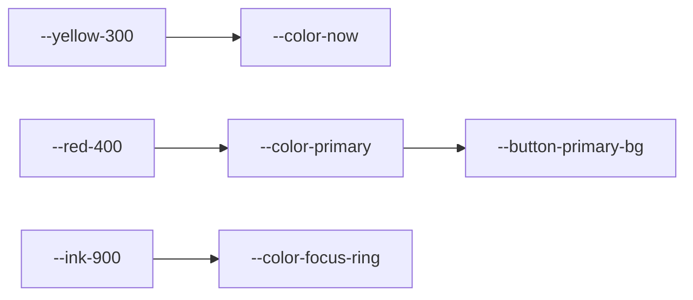

# デザイントークン
> 版：v0.8（2026-11-10）｜ 関連：[02_visual_direction](02_visual_direction.md)

> **3行で**
> - 実装者が色、文字、寸法を取る正本。生の値はここにだけ書く。
> - モックの値を primitive、semantic、component の3層に分けた。
> - 文字は最小 16px に上げ、大きさは4段に絞った。

## 🧭 判断してほしいこと

| # | 種類 | 論点 | 選択肢 | おすすめ（理由） | 決まらないと止まるもの |
| --- | --- | --- | --- | --- | --- |
| R-03 | リスク | マーカーの色は紙との差が小さい | ― | 塗りは濃い線で囲み、文字色に使わない | CMP 全般 |

## 全体図



## 要点
- 色の役割は、ベース、主色、今ここ、終わった、花丸、教科の識別、分野の識別に分ける。
- ダークモードは作らない。
- 影のトークンは持たない。例外は PG-001 の 3D の中の影の色だけ。
- 300ms を超えるのは、歩く動きと島へ寄る動き。理由は [06_motion](06_motion.md)。
- PG-001 の 3D の色もこのトークンから読み、JS に色の値を書かない。

## 詳細

### 色

<details>
<summary>primitive</summary>

```css
:root {
  --paper-50: #fafaf5;
  --grid-200: #dfe7f1;
  --graphite-600: #4a4c52;
  --ink-500: #566480;
  --ink-700: #3a4a6b;
  --ink-900: #1f2942;
  --red-400: #ff6b6b;
  --red-600: #d93a3a;
  --blue-700: #1d4fb8;
  --teal-300: #4ecdc4;
  --yellow-300: #ffe066;
  --pink-300: #ff8f8f;
  --green-300: #9fdc6f;
  --orange-300: #ffbf6b;
  --purple-300: #b9a5f2;
  --sea-100: #e9fbf8;
  --sea-200: #a4e6e0;
  --sea-300: #5cc8d6;
  --sea-400: #2fa6c9;
  --foam-0: #ffffff;
  --bird-50: #fdfdf8;
  --palm-500: #3f9a58;
  --trunk-400: #b08a5e;
  --sand-200: #f3e3bf;
  --desk-300: #e8dcc4;
  --edge-100: #f2efe6;
}
```

</details>

| semantic トークン | 値 | 役割と用途 |
| --- | --- | --- |
| `--color-bg` | `var(--paper-50)` | ベース。紙、パネル |
| `--color-grid` | `var(--grid-200)` | ベース。方眼 |
| `--color-margin-line` | `var(--red-400)` | ベース。余白の赤い線 |
| `--color-fg` | `var(--ink-700)` | ベース。本文 |
| `--color-fg-strong` | `var(--ink-900)` | ベース。見出し、ボタンの文字、数字 |
| `--color-muted-fg` | `var(--ink-500)` | ベース。補足、鍵の付いた物 |
| `--color-border` | `var(--ink-700)` | ベース。部品の線 |
| `--color-border-strong` | `var(--ink-900)` | ベース。主ボタン、パネルの線 |
| `--color-primary` | `var(--red-400)` | 主色。主ボタンと、選んだ数の札（CMP-022、D-132）だけ |
| `--color-on-primary` | `var(--ink-900)` | 主色の上の文字 |
| `--color-now` | `var(--yellow-300)` | 今ここ。今のマス、今の章、算数の島の縁、着けている装備、トースト |
| `--color-done` | `var(--teal-300)` | 状態。終わったマス、通った道 |
| `--color-stamp` | `var(--red-600)` | 状態。花丸 |
| `--color-focus-ring` | `var(--ink-900)` | フォーカス |
| `--color-link` | `var(--blue-700)` | 先生の画面のリンク。下線と組にする（D-213） |
| `--color-scrim` | `rgb(31 41 66 / 0.4)` | パネルの後ろ |
| `--color-subject-kokugo` | `var(--pink-300)` | 教科の識別 |
| `--color-subject-sansu` | `var(--teal-300)` | 教科の識別 |
| `--color-subject-rika` | `var(--green-300)` | 教科の識別 |
| `--color-subject-shakai` | `var(--orange-300)` | 教科の識別 |
| `--color-subject-eigo` | `var(--purple-300)` | 教科の識別 |
| `--color-subject-ongaku` | `var(--blue-300)` | 教科の識別 |
| `--color-subject-taiiku` | `var(--rose-300)` | 教科の識別 |
| `--color-subject-zuko` | `var(--olive-300)` | 教科の識別 |
| `--color-subject-katei` | `var(--clay-300)` | 教科の識別 |
| `--color-subject-seikatsu` | `var(--meadow-300)` | 教科の識別。生活（D-123） |
| `--color-domain-number` | `var(--blue-300)` | 分野の識別。数と計算。PG-004 の札の上の帯、道、色の見本（D-97） |
| `--color-domain-shape` | `var(--orange-300)` | 分野の識別。図形 |
| `--color-domain-change` | `var(--purple-300)` | 分野の識別。変化と関係 |
| `--color-domain-data` | `var(--green-300)` | 分野の識別。データの活用 |
| `--color-sea-shallow` | `var(--sea-200)` | PG-001 の海。一番上の紙 |
| `--color-sea-mid` | `var(--sea-300)` | PG-001 の海。真ん中の紙 |
| `--color-sea-deep` | `var(--sea-400)` | PG-001 の海。一番下の紙 |
| `--color-tissue` | `var(--sea-100)` | PG-001 の海に重ねるチリ紙の帯 |
| `--color-foam` | `var(--foam-0)` | PG-001 の島のふちに寄せるチリ紙の輪 |
| `--color-fish-shadow` | `rgb(20 80 111 / 0.34)` | PG-001 の魚の影 |
| `--color-bird` | `var(--bird-50)` | PG-001 の鳥 |
| `--color-pencil-line` | `var(--graphite-600)` | CMP-012 の鉛筆の線 |
| `--color-wind-line` | `rgb(255 255 255 / 0.75)` | PG-001 の白い風の線 |
| `--color-palm-leaf` | `var(--palm-500)` | PG-001 の高原の木の葉、教科の飾りの葉と地球儀の陸 |
| `--color-palm-trunk` | `var(--trunk-400)` | PG-001 の高原の木の幹、教科の飾りの木の部分 |
| `--color-sand` | `var(--sand-200)` | PG-001 の島の下の段 |
| `--color-meadow` | `var(--meadow-200)` | PG-001 の高原の草地、丘の下の段 |
| `--color-meadow-low` | `var(--meadow-300)` | PG-001 の高原の草地の下の紙 |
| `--color-desk` | `var(--desk-300)` | PG-001 の机 |
| `--color-paper-edge` | `var(--edge-100)` | PG-001 の紙の切り口 |
| `--color-diorama-shadow` | `rgb(31 41 66 / 0.22)` | PG-001 の 3D の中の影 |
| `--color-figure-beam` | `var(--orange-300)` | PG-010 のてこのうで（CMP-033） |
| `--color-figure-weight` | `var(--blue-300)` | PG-010 のおもりと、読みとりの棒の塗り（CMP-031、CMP-033） |
| `--color-figure-light` | `var(--yellow-300)` | PG-010 の太陽の光と、月の光っている側（CMP-034） |
| `--color-figure-earth` | `var(--blue-300)` | PG-010 の地球（CMP-034） |
| `--color-figure-moon-dark` | `var(--ink-500)` | PG-010 の月の影の側（CMP-034） |
| `--color-figure-lasso` | `var(--yellow-300)` | PG-010 の囲む線（CMP-032）。外に `--color-border-strong` の縁を付ける |

### コントラスト

`contrast.py` の計算結果。

| 前景 | 背景 | 比 | 通常文字 4.5 | 大きい文字 3 | UI 部品 3 | 使い方 |
| --- | --- | --- | --- | --- | --- | --- |
| `#3A4A6B` | `#FAFAF5` | 8.46:1 | OK | OK | OK | 本文 |
| `#566480` | `#FAFAF5` | 5.68:1 | OK | OK | OK | 補足 |
| `#1F2942` | `#FAFAF5` | 13.79:1 | OK | OK | OK | 見出し |
| `#1D4FB8` | `#FAFAF5` | 7.01:1 | OK | OK | OK | 先生の画面のリンク（`--color-link`） |
| `#3A4A6B` | `#DFE7F1` | 7.10:1 | OK | OK | OK | 方眼の線に重なる本文 |
| `#566480` | `#DFE7F1` | 4.77:1 | OK | OK | OK | 方眼の線に重なる補足 |
| `#1F2942` | `#FF6B6B` | 5.20:1 | OK | OK | OK | 主ボタン |
| `#1F2942` | `#FFE066` | 11.08:1 | OK | OK | OK | 今のマス、トースト |
| `#566480` | `#FFE066` | 4.56:1 | OK | OK | OK | 使ってよいが避ける |
| `#1F2942` | `#4ECDC4` | 7.46:1 | OK | OK | OK | 終わったマス |
| `#1F2942` | `#FF8F8F` | 6.59:1 | OK | OK | OK | 国語 |
| `#1F2942` | `#9FDC6F` | 8.90:1 | OK | OK | OK | 理科 |
| `#1F2942` | `#8FB8F7` | 7.13:1 | OK | OK | OK | PG-010 のおもりの文字（CMP-033） |
| `#1F2942` | `#FFBF6B` | 8.88:1 | OK | OK | OK | PG-010 のてこのうでの線 |
| `#1F2942` | `#FFBF6B` | 8.88:1 | OK | OK | OK | 社会 |
| `#1F2942` | `#B9A5F2` | 6.69:1 | OK | OK | OK | 英語 |
| `#1F2942` | `#8FB8F7` | 7.13:1 | OK | OK | OK | 音楽 |
| `#1F2942` | `#F39AC6` | 7.05:1 | OK | OK | OK | 体育 |
| `#1F2942` | `#D6CB58` | 8.63:1 | OK | OK | OK | 図工 |
| `#1F2942` | `#D2A97F` | 6.69:1 | OK | OK | OK | 家庭 |
| `#1F2942` | `#CFE8A8` | 10.84:1 | OK | OK | OK | 草地の上のフォーカス |
| `#1F2942` | `#AED68B` | 8.80:1 | OK | OK | OK | 草地の上のフォーカス |
| `#1F2942` | `#A4E6E0` | 10.30:1 | OK | OK | OK | 海の上の見出し、フォーカス |
| `#1F2942` | `#5CC8D6` | 7.35:1 | OK | OK | OK | 海の上の見出し、フォーカス |
| `#1F2942` | `#2FA6C9` | 5.10:1 | OK | OK | OK | 海の上の見出し、フォーカス |
| `#3A4A6B` | `#A4E6E0` | 6.31:1 | OK | OK | OK | 海の上の線 |
| `#3A4A6B` | `#5CC8D6` | 4.51:1 | OK | OK | OK | 海の上の線 |
| `#1F2942` | `#F3E3BF` | 11.38:1 | OK | OK | OK | 砂の上のフォーカス、すごろくの道の縁 |
| `#3A4A6B` | `#F3E3BF` | 6.98:1 | OK | OK | OK | すごろくの道のまん中の点線 |
| `#1F2942` | `#E8DCC4` | 10.64:1 | OK | OK | OK | 机の上の見出し |
| `#D93A3A` | `#FAFAF5` | 4.34:1 | NG | OK | OK | 花丸の図形だけ。文字に使わない |
| `#D93A3A` | `#FFE066` | 3.49:1 | NG | OK | OK | 花丸の図形だけ。文字に使わない |
| `#FF6B6B` | `#FAFAF5` | 2.65:1 | NG | NG | NG | 塗りだけ。必ず線で囲む |
| `#4ECDC4` | `#FAFAF5` | 1.85:1 | NG | NG | NG | 塗りだけ。必ず線で囲む |
| `#FFE066` | `#FAFAF5` | 1.25:1 | NG | NG | NG | 塗りだけ。必ず線で囲む |

教科の色は紙と 1.55〜2.09:1 なので、同じく塗りだけに使う。分野の色は教科の色と同じ primitive なので、上の表の比がそのまま当たる。章の番号の丸は `--color-border-strong` の線で囲み、番号の文字は鍵の章でも `--color-fg-strong`（分野の色の上で 6.69〜8.90:1）にする。`--color-muted-fg` は分野の色の上で 2.76〜3.67:1 しかないので使わない（D-109）。分野名は色の見本の横に文字で書く（色だけで分野を伝えない）。通った道の緑は飾りで、終わったことはチェックの印で伝える。

PG-001 の 3D の色は光で明るさが変わる。文字とフォーカスの判定は、光の影響を受けない付箋（CMP-004）で満たす。見出しの見え方は実物で確かめる。

### 文字

| トークン | 大きさ | 太さ | 行間 | 用途 |
| --- | --- | --- | --- | --- |
| `--text-display` | 34px | 400 | 1.2 | PG の見出し、Yomogi |
| `--text-title` | 30px | 400 | 1.3 | パネルの見出し、Lv、マスの数字、Yomogi |
| `--text-body` | 18px | 500 | 1.7 | 本文、ボタン |
| `--text-small` | 16px | 500 | 1.35 | 補足、章の道 |
| `--text-strong-weight` | ― | 800 | ― | ボタン、今のマスの名前 |
| `--ruby-size` | 0.6em | ― | ― | ふりがな |

- `--font-hand`：`"Yomogi", "Hiragino Maru Gothic ProN", "Yu Gothic", sans-serif`
- `--font-body`：`"M PLUS Rounded 1c", "Hiragino Maru Gothic ProN", "Yu Gothic", sans-serif`
- 読み込み：Google Fonts。Yomogi と M PLUS Rounded 1c の 500 と 800。`display=swap`

### 余白とレイアウト

| トークン | 値 | 用途 |
| --- | --- | --- |
| `--space-1`〜`--space-7` | 4 / 8 / 12 / 16 / 20 / 24 / 32px | 部品の中と間 |
| `--grid-size` | 28px | 方眼の大きさ |
| `--content-max-width` | 1040px | SEC-002-04 と SEC-002-05 を合わせた幅。768px 以上の PG-002 では使わず、画面を左右半分に分ける（D-112） |

### 形と重なり

| トークン | 値 |
| --- | --- |
| `--radius-hand` | `255px 18px 225px 18px / 18px 225px 18px 255px` |
| `--radius-blob` | `52% 48% 55% 45% / 46% 54% 47% 53%` |
| `--radius-slot` | `10px 12px 8px 14px` |
| `--stroke-2 / 3 / 4` | 2 / 3 / 4px |
| `--z-walker / --z-toast` | 2 / 3 |
| `--z-over-loading` | 6（CMP-012 の 5 より手前。PG-001 の見出しに使う） |
| `--z-corner` | 4（CMP-043 右上の音と顔。画面の中身より上、CMP-012 の 5 と戻る波・読み込み中の 6 より下。D-245） |
| `--corner-reserve` | `calc(var(--space-4) + 2 * (var(--button-min-height) - var(--space-2)) + var(--space-3))`。767px 以下は 44px の所を `--button-min-height`。上の帯が右に空ける幅（D-245） |

パネルは `dialog` の最前面に出るので z-index を持たない。

### 動き

| トークン | 値 | 用途 |
| --- | --- | --- |
| `--duration-fast` | 120ms | 押した反応 |
| `--duration-normal` | 180ms | パネル、トースト |
| `--duration-meter` | 500ms | メーター |
| `--duration-shutter-flash` | 150ms | MOT-030 の光（D-200） |
| `--duration-shutter-print` | 600ms | MOT-030 のせり出し（D-200） |
| `--duration-walk` | 620ms | 歩く |
| `--duration-hop` | 310ms | 跳ねる |
| `--duration-paper` | 240ms | 盤面の紙が広がる |
| `--duration-peek` | 360ms | 鍵の島へ少し寄る |
| `--duration-peek-back` | 480ms | 鍵の島から戻る |
| `--duration-zoom-back` | 800ms | 使わない（MOT-011 を取り消した。D-103）。実装で外す |
| `--duration-wave` | 3000ms | 戻る時に海の波が寄せて引く（MOT-024）。波で待つ間の打ち寄せる間隔も同じ（D-141）。900ms から 1400ms（D-151）、2000ms（D-154）、3000ms（D-240）に延ばした |
| `--duration-zoom` | 1200ms | 算数の島へ寄る |
| `--duration-breathe` | 2000ms | MOT-025 困った時のボタンの光が1回息づく（D-129） |
| `--duration-draw` | 5000ms | 人の線が現れる |
| `--duration-scribble` | 1200ms | えんぴつの「かきかき」の1周 |
| `--duration-draw-hold` | 800ms | 描き上がった絵を見せる |
| `--duration-step-hold` | 1200ms | PG-010 の「さいせい」で、1 手順ごとに止まって見せる長さ（MOT-027） |
| `--duration-goo` | 520ms | MOT-031 音のボタンの札が伸びる。行き過ぎて戻る分を含む（D-241） |
| `--delay-loading` | 300ms | ローディングを出すまで待つ |
| `--duration-loading-min` | 500ms | 出したローディングを残す最短の長さ |
| `--ease-out` | `cubic-bezier(0.23, 1, 0.32, 1)` | 出る、押す |
| `--ease-in-out` | `cubic-bezier(0.77, 0, 0.175, 1)` | 歩く、引く |
| `--ease-soft` | `cubic-bezier(0.45, 0, 0.55, 1)` | MOT-025 の息づき。始めと終わりをなだらかにする（D-129） |
| `--ease-zoom` | `cubic-bezier(0.6, -0.3, 0.2, 1)` | 島へ寄る。最初に少し引いて溜める |
| `--ease-goo` | `linear(0, 0.22 8%, 0.62 18%, 0.98 30%, 1.13 40%, 1.12 48%, 1.03 60%, 0.98 72%, 1.005 86%, 1)` | MOT-031。約 13% 行き過ぎて1回だけ弾み、戻る（D-241） |

### `index.html` に書き写す値

起動のローディング（CMP-012）はアプリの CSS より先に出すため、次の値を `web/index.html` に書き写している（R-10）。変えるときは両方を直す。`web/src/loading-boot.test.ts` が一致を確かめる。絵とキーフレームは `scripts/gen-loading-art.mjs` が作るので、絵や `--duration-draw` を変えたら実行し直す。

| トークン | 値 |
| --- | --- |
| `--paper-50` | `#fafaf5`（`--color-bg` の値） |
| `--grid-200` | `#dfe7f1`（`--color-grid` の値） |
| `--ink-700` | `#3a4a6b`（`--color-fg` の値） |
| `--graphite-600` | `#4a4c52`（`--color-pencil-line` の値） |
| `--yellow-300` | `#ffe066` |
| `--orange-300`、`--sand-200`、`--ink-500`、`--pink-300` | 鉛筆の部品の色（影の面、木、金具、消しゴム） |
| `--grid-size` | 28px |
| `--text-body` | 18px |
| `--text-body-weight` | 500 |
| `--text-body-line` | 1.7 |
| `--loading-art-width` | 200px |
| `--font-hand` | `"Yomogi", "Hiragino Maru Gothic ProN", "Yu Gothic", sans-serif` |
| `--duration-draw` と `--duration-draw-hold` | 足した 5800ms を繰り返しの周期にする |
| `--duration-scribble` | 1200ms |
| `--delay-loading` | 300ms |
| `--duration-normal` | 180ms |

### component トークン

| トークン | 値 | 使う CMP |
| --- | --- | --- |
| `--button-min-height` | 52px | CMP-001 |
| `--button-primary-bg` | `var(--color-primary)` | CMP-001 |
| `--tab-min-size` | 48px | 使わない（D-98）。実装で外す |
| `--cell-size` | 54px | CMP-006 |
| `--cell-size-test` | 64px | CMP-006 章のテスト |
| `--cell-size-side` | 42px | CMP-006 寄り道 |
| `--board-cols` | 4 | CMP-006 S字の1行のマスの数の上限（D-112）。章ごとの数は Road.tsx が `ceil(マス数 ÷ 行の数)` で決めて盤面の枠に付ける（D-113） |
| `--board-col-step` | 96px | CMP-006 同じ行のマスの中心どうしの間隔（D-112） |
| `--board-step` | 136px | CMP-006 行と行の中心の間隔。折り返しの半円の直径、寄り道はこの半分だけ下（D-112） |
| `--board-box-width` | 512px | 4列3行の盤面の枠の幅。章ごとの幅は Road.tsx が「左の余白 + (列の数 − 1) × 96 + 右の余白」で決め、`--board-box-w`（単位なし）で枠に付ける。余白は折り返しの半円が出る側が 112（半円の半径と道の帯の半分）、出ない側が 64（D-113） |
| `--board-box-height` | 460px | 3行の盤面の枠の高さ。章ごとの高さは Road.tsx が「行の数 × 136 + 52」で決め、`--board-box-h`（単位なし）で枠に付ける（D-113） |
| `--board-side-offset` | ― | 使わない（D-112）。寄り道は真下に置く |
| `--board-row-height` | ― | 使わない（縦1列の案と D-112）。実装で外す |
| `--board-side-drop` | ― | 使わない（D-112）。寄り道の位置は `--board-step` の半分 |
| `--board-side-shift` | ― | 使わない（D-112）。寄り道は真下に置き、折り返しの半円に重ならない |
| `--board-road-width` | 34px | CMP-007 PG-002 の道の砂色の帯。縁取りは左右に `--stroke-3`（D-110） |
| `--board-unit` | 767px 以下は `clamp(0.7px, (100vw − 2 × --space-4) ÷ --board-box-w, 1px)`。768px 以上は左の欄（`container-type: size`）を基準に `clamp(0.85px, min(100cqw ÷ --board-box-w, 100cqh ÷ --board-box-h), 1.8px)` | PG-002 の盤面の枠を左の欄（767px 以下は画面の幅）に収める単位（D-112。D-102 の式を替えた）。枠の大きさは章ごと（D-113）。下の `*-wide` と枠の大きさはこれを掛けた値 |
| `--cell-size-wide` | 54 × `--board-unit` | `--cell-size` |
| `--cell-size-test-wide` | 64 × `--board-unit` | `--cell-size-test` |
| `--cell-size-side-wide` | 42 × `--board-unit` | `--cell-size-side`。見た目が 44px より小さい時も、押せる範囲は外へ広げて 44px 以上にする |
| `--board-col-step-wide` | 96 × `--board-unit` | `--board-col-step` |
| `--board-step-wide` | 136 × `--board-unit` | `--board-step` |
| `--board-road-width-wide` | 34 × `--board-unit` | `--board-road-width` |
| `--board-side-offset-wide` | ― | 使わない（D-112） |
| `--walker-width-road-wide` | 46 × `--board-unit` | `--walker-width-road`（PG-002 だけ） |
| `--cell-text-wide` | 30 × `--board-unit` | マスの数字（ふだんは `--text-title`） |
| `--cell-text-side-wide` | 16 × `--board-unit` | 寄り道の「寄」（ふだんは `--text-small`） |
| `--board-pad-wide` | ― | 使わない（D-112）。余白は枠の大きさに含めた |
| `--road-row-default` | 62px | 使わない（D-99）。実装で外す |
| `--road-row-min` | 44px | 使わない（D-99）。実装で外す |
| `--road-row-max` | 84px | 使わない（D-99）。実装で外す |
| `--card-width` | 400px | CMP-014（使わない。767px 以下は全幅、768px 以上は `--card-width-wide`） |
| `--card-width-wide` | 560px | CMP-014 の右半分での幅の上限。右半分の中で左右の中央に置く（D-112） |
| `--card-max-height-narrow` | 50dvh | CMP-014（767px 以下）の高さの上限。本文はカードの中で縦に送る（D-118）。高さ 599px 以下は固定をやめ、この上限も使わない（D-252） |
| `--board-pane-ratio` | 50% | 768px 以上の PG-002 で、左の盤面が占める幅。残りが右の説明（D-112） |
| `--face-size` | 52px | CMP-015（PG-002、PG-004） |
| `--drawer-width` | 360px | 使わない（D-196 で CMP-015 の引き出しをやめた）。実装で外す |
| `--account-drawer-width` | 400px | CMP-028。内側 352px に種類のタブ5つ（336px）と候補5列（352px）が入る（D-194） |
| `--account-photo-size` | 72px | CMP-040 の上の写真（D-194） |
| `--photo-cheki-width` | 144px | CMP-040 のチェキ。絵は 128px の四角、ふちは左右と上 8px、下 32px で高さ 168px（D-198） |
| `--photo-choice-size` | 64px | CMP-028 の候補の升目、CMP-009（D-195、D-198） |
| `--photo-roster-size` | 32px | CMP-040 の名簿の丸（先生の画面。D-199） |
| `--island-size` | 124px | CMP-004 |
| `--tag-min-height` | 48px | CMP-004 付箋 |
| `--tag-min-width` | 88px | CMP-004 付箋 |
| `--walker-width` | 62px | CMP-002（PG-001） |
| `--walker-width-road` | 46px | CMP-002（PG-002） |
| `--avatar-size-drawer` | 128px | 使わない（D-194 で CMP-028 は CMP-040 に替えた）。実装で外す |
| `--avatar-size-side` | 128px | CMP-002（PG-003 のアバター） |
| `--loading-art-width` | 200px | CMP-012 |
| `--avatar-size-mirror` | 160px | CMP-002 |
| `--avatar-size-levelup` | 180px | CMP-002 |
| `--account-gear-size` | 48px | 使わない（D-195 で装備の列を CMP-028 のアバターのタブの候補に替えた）。実装で外す |
| `--avatar-pick-size` | 64px | CMP-030 の絵（4列で 292px。D-161） |
| `--panel-width` | 440px | CMP-008 |
| `--locker-width` | 620px | 使わない（D-195）。実装で外す |
| `--chapter-panel-width` | 960px | 使わない（D-97）。実装で外す |
| `--chapter-card-width` | 200px | CMP-017 章の札。767px 以下は `--chapter-card-width-narrow` |
| `--chapter-card-width-narrow` | 180px | CMP-017 章の札（767px 以下。1行1章、D-109） |
| `--chapter-card-min-height` | 88px | CMP-017 章の札（PG-004） |
| `--chapter-card-min-height-island` | 76px | CMP-017 章の札（PG-005。D-134） |
| `--chapter-band` | 10px | PG-005 の章札の上の教科の色の帯。PG-004 では使わない（D-109） |
| `--chapter-badge-size` | 32px | CMP-017 札の左上の章の番号の丸（D-109） |
| `--chapter-row-height` | 170px | PG-004 の章の地図の1行の高さ。折り返しの半円の直径にもなる。767px 以下は `--chapter-row-height-narrow` |
| `--chapter-row-height-narrow` | 118px | PG-004 の章の地図の1行の高さ（767px 以下） |
| `--domain-road-width` | 10px | 使わない（D-109）。実装で外す |
| `--chapter-road-width` | 50px | CMP-007 PG-004 の道の砂色の帯。縁取りは左右に `--stroke-4`。767px 以下は `--chapter-road-width-narrow`（D-109） |
| `--chapter-road-width-narrow` | 38px | CMP-007 PG-004 の道（767px 以下） |
| `--toast-duration` | 4000ms | CMP-010 |
| `--teacher-row-height` | 40px | teacher の SCR-T10 の表の行、SCR-T04 のマスの一覧の行（D-177） |
| `--progress-cell-width` | 60px | CMP-036（SCR-T10 の章の列。16章まで並ぶ幅。D-179） |
| `--progress-bar-height` | 4px | CMP-036 の棒（D-179）。SCR-T04 の札の中 |
| `--progress-bar-height-table` | 12px | CMP-036 の棒。SCR-T10 の表の中（数字を出さない。D-182） |
| `--teacher-chapter-card-cols` | 4 | CMP-037 の列の数（D-180） |
| `--teacher-chapter-card-height` | 96px | CMP-037（D-180） |
| `--teacher-loop-ring-width` | 560px | teacher の SCR-T10「学びの輪」の図の幅（1024px 以上。D-217） |

## このドキュメントで決まったこと
- [決定事項ログ](00_brief.md#決定事項ログ) の D-17, D-18, D-22, D-24, D-25, D-30, D-31, D-34, D-160, D-161, D-194〜D-200
